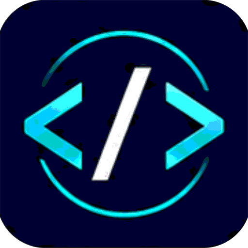

# NEXORA / NXL

<p align="center">
  
</p>

An open-source programming language and toolchain: a compiler, a bytecode VM,
a JavaScript backend, a package manager, a REPL and a development server.

```bash
nexora new console hello
cd hello
nexora run        # Hello, NXL!
```

## Status

Version 0.1.0. The language roadmap (errors and strings, iteration and data,
objects and methods, modules, concurrency, backend control flow) is implemented
and covered by 572 automated tests.

| Area          | State                                                        |
| ------------- | ------------------------------------------------------------ |
| Language      | Phases 1-6 implemented; see the language reference            |
| VM            | Authoritative execution path for every program                |
| JS backend    | Native loops, `try`, classes and modules; VM-parity tested    |
| Rust backend  | Straight-line code and `try`; refuses the rest honestly       |
| Concurrency   | `spawn`/`await`, channels and actor mailboxes (VM only)       |
| Package mgr   | Local path dependencies, local registry, SHA-256 lockfile     |
| REPL          | Persistent session with replay from a transcript file         |
| Dev server    | `nexora dev` serves a project and live-reloads on change      |
| Editor        | VS Code extension for `.nxl` highlighting, icon and commands  |
| Releases      | Windows x64 locally; Linux/macOS built and self-tested in CI  |

Not yet available: a hosted package registry, package signing, code-signed
installers. The development server compiles to JavaScript and watches the
project; it does not yet run NXL on the server side.

## Install

Download the archive for your platform and run its installer:

- **Windows** (`install.ps1` or `install.bat`) — installs for the current user
  and adds `nxlc` to your user PATH.
- **Linux / macOS** (`install.sh`) — installs to `~/.nexora/bin` and updates
  `~/.nexora/env`.

Both installers verify the SHA-256 checksum before copying anything and refuse
to run on the wrong platform. See [docs/02-installation.md](docs/02-installation.md)
and [docs/platform-support.md](docs/platform-support.md) for exactly which
platforms are built and tested.

## Build from source

```bash
cd compiler
cargo build --release
cargo test
```

Only Rust is required. Node.js is optional: with it the JavaScript backend can
also run programs; without it everything runs on the VM.

## Documentation

| Document                                              | Contents                        |
| ----------------------------------------------------- | ------------------------------- |
| [docs/01-getting-started.md](docs/01-getting-started.md) | Install, first project         |
| [docs/02-installation.md](docs/02-installation.md)       | Installation                   |
| [docs/03-cli-reference.md](docs/03-cli-reference.md)     | Every command                   |
| [docs/04-language-reference.md](docs/04-language-reference.md) | Language and phases       |
| [docs/05-compiler-and-vm.md](docs/05-compiler-and-vm.md) | Compiler and VM internals    |
| [docs/09-nxp.md](docs/09-nxp.md)                         | Package manager                |
| [docs/12-security.md](docs/12-security.md)               | Security model                  |
| [docs/platform-support.md](docs/platform-support.md)     | What is built and tested        |
| [SECURITY.md](SECURITY.md)                               | Reporting vulnerabilities       |
| [CHANGELOG.md](CHANGELOG.md)                             | Release history                 |
| [CONTRIBUTING.md](CONTRIBUTING.md)                       | How to contribute               |

## Repository layout

```
compiler/        the compiler and toolchain (Rust)
dist/            generated release output
dist-brand/      the generated logo used by this README and the docs
examples/        runnable examples
templates/       project templates (`nexora new console`)
install/         installer sources per platform
editors/         editor integrations (VS Code extension)
scripts/         packaging, verification and brand-asset scripts
docs/            documentation
tests/           legacy Python reference prototype (superseded by compiler/tests)
```

`dist/` is generated: `scripts/package-release.ps1` (Windows) and
`scripts/package-release.sh` (Linux/macOS) rebuild it, run the quality gates,
verify the artifact they are about to publish, and produce the archive.

## Contributing

Contributions are welcome — see [CONTRIBUTING.md](CONTRIBUTING.md) and
[CODE_OF_CONDUCT.md](CODE_OF_CONDUCT.md). Every change should keep the test
suite green (`cargo test`, 572 tests) and `cargo clippy --all-targets -- -D
warnings` clean; the release pipeline enforces both.

Changing `favicon.ico` means regenerating the brand assets:

```powershell
powershell -NoProfile -ExecutionPolicy Bypass -File scripts/make-brand-assets.ps1
node editors/vscode-nxl/scripts/verify-extension.js
```

## License

Released under the [MIT License](LICENSE).

## Security

Please report vulnerabilities privately as described in
[SECURITY.md](SECURITY.md) rather than in a public issue.