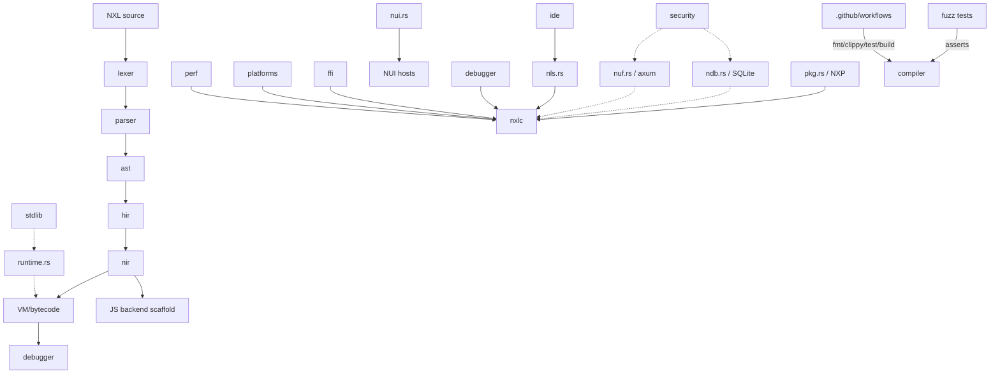

# Architecture

Key invariants: the compiler crate is the only semantic source of truth (NIDE/NLS/NUF/NDB/NXP are clients of it). Intermediate form `NIR` carries spans used by the bytecode VM's `DebugSpan` opcode. No real native backend yet — `backend.rs` emits JS skeletons; do not treat it as a native target.
